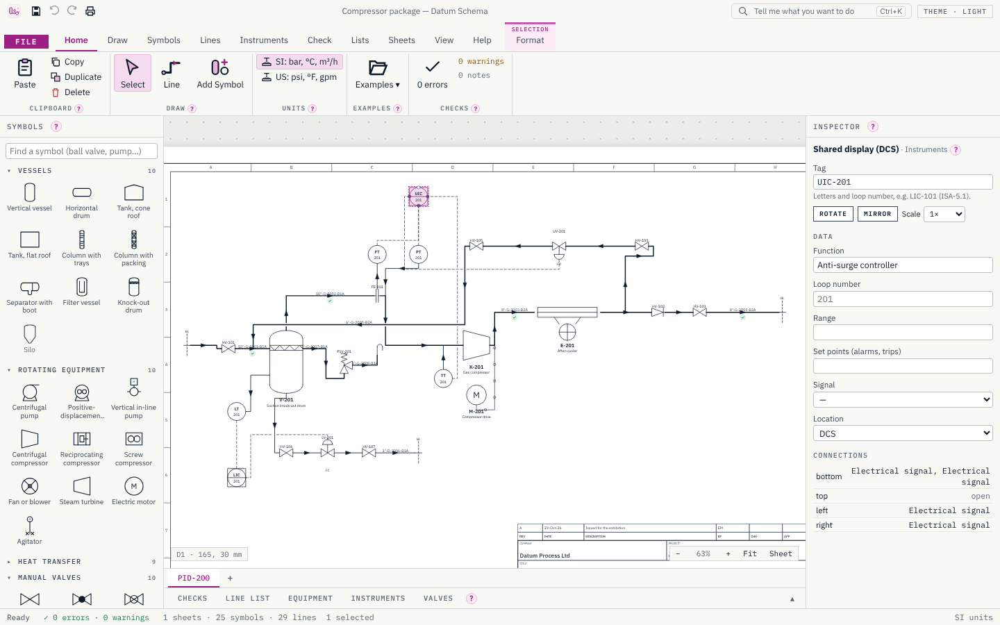
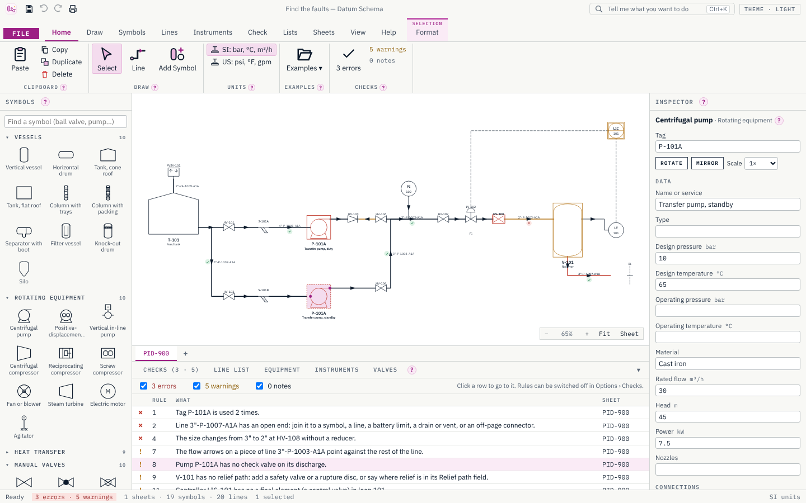
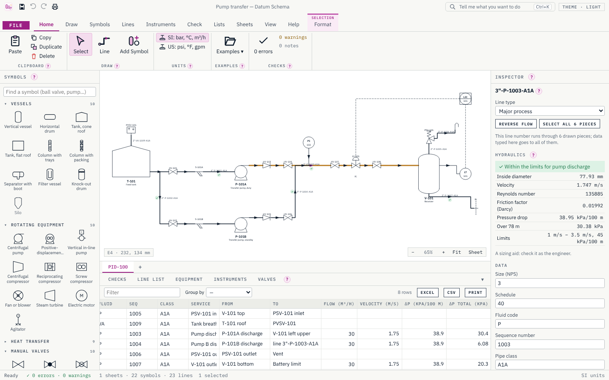

<p align="center"></p>

<h1 align="center">Datum Schema</h1>

<p align="center">Intelligent P&IDs and process flow diagrams: draw, check and list.</p>

<p align="center">
  <a href="https://github.com/Edgar-Mendonca/Datum-Schema/releases"></a>
  <a href="https://github.com/Edgar-Mendonca/Datum-Schema/actions/workflows/ci.yml"></a>
  <a href="https://github.com/Edgar-Mendonca/Datum-Schema/releases"></a>
  
  
  
  
  
</p>

<p align="center">
  <a href="https://github.com/Edgar-Mendonca/Datum-Schema/releases/latest"></a>
  <a href="CHANGELOG.md"></a>
  <a href="docs/MEMORY.md"></a>
</p>



Draw the plant with real symbols, and every symbol and line carries its data and knows what it is connected to. So Datum Schema writes the line list, equipment list, instrument index and valve list for you, always in step with the drawing; checks the drawing as you work; and sizes every line, with its velocity and pressure drop against limits. It is for process, chemical, mechanical, piping and instrument engineers, operators and students. It is free and open source (MIT), Windows first, installs in seconds and updates itself. More on the family site: [edgar-mendonca.github.io/Datum/apps/schema](https://edgar-mendonca.github.io/Datum/apps/schema).

> **Hydraulic results are a sizing aid.** Velocities and pressure drops help you size lines; they are checked by the engineer before they are used.

## What it does

- **Real symbols**: about 80 of our own drawings following ISO 10628-2 (equipment, valves, lines) and ISA-5.1 (instrument bubbles and letters), with their connection points.
- **Lines that know their ends**: drawn port to port, routed at right angles around symbols, with flow arrows and hops; a valve dropped on a line goes into it; off-page connectors carry a line to another sheet.
- **Data on everything**: tags, services, design and operating conditions, sizes, line numbers built from size, fluid, sequence and class, in SI or US units.
- **Sheets**: A3, A1, ANSI B and ANSI D with border, grid zones, title block and revision table; a legend sheet.
- **Live checks**: thirteen rules on every change (duplicate tags, open ends, size changes without a reducer, class changes without a spec break, pumps without check valves, vessels without relief, control loops, hydraulic limits and more), each a click away from the problem.
- **Line hydraulics**: inside diameter from size and schedule, velocity, Reynolds number, Colebrook friction factor, pressure drop per 100 m and over the line, with a ✓ ! ✗ badge against the limits for its service.
- **Lists**: line list, equipment list, instrument index and valve list, always in step with the drawing; edit them, export to Excel or CSV, print them.
- **Print and export**: PDF (sheets at their size or fitted to A3, lists, legend), SVG, and DXF (R12) that opens in any CAD program.
- **Examples**: a pump transfer, a compressor package, a steam heater loop, and "Find the faults".
- **Safe files**: `.dschema` projects (JSON), atomic saves, recovery of unsaved work, undo and redo for everything.





## The two-minute demo

1. File › Examples › **Find the faults**: the Checks panel lists three errors and five warnings, and the status bar counts them.
2. Click "Pump P-101A has no check valve on its discharge": the pump is selected on the drawing. Drag a check valve from the palette onto its discharge line; the issue clears.
3. Click the duplicate tag issue and rename the standby pump P-101B in the Inspector; the issue clears.
4. Open the **Line list**: every line number with its from and to, flow, velocity and pressure drop. Click a line on the drawing to see its hydraulics and its ✓, ! or ✗ badge.
5. File › Print: the sheet with its title block, then the lists. Sheets › DXF writes the drawing for any CAD program.

## Build

```bash
npm ci
npm run build:ui
cargo build -p datum-schema --release
```

Checks before every push: `cargo clippy --workspace --all-targets -- -D warnings`, `cargo test --workspace`, `npm run check:ui`, `npm run test:ui`, `cargo deny check`.

## Licence

MIT © 2026 Edgar Mendonca. See [NOTICE](NOTICE) for the fonts and crates it uses.
